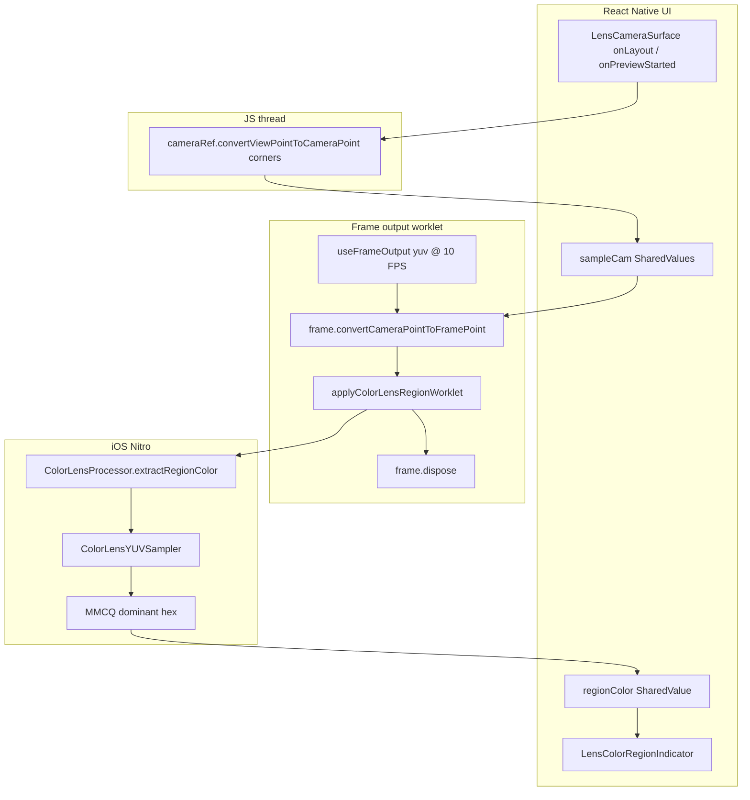

# Lens Point — UI + Native Context

Handoff doc for **lens-point** color sampling (`COLOR_LENS_MODE.LENS_POINT`). Describes how the on-screen indicator, JS frame output, VC5 coordinate conversions, and iOS Nitro processor connect.

**Dominant** palette mode uses the same frame output: JS-thread viewport corners → worklet `convertCameraPointToFramePoint` → `ColorLensProcessor.extractFramePalette(frame, rect)` (YUV sample + MMCQ). No GPU resizer.

---

## Product behavior (today)

- User cycles color-lens mode via top controls: `disabled → lens-dominant → lens-point → disabled`.
- In **lens-point** mode:
  - A **fixed-center** circular ring sits over the camera preview (no drag yet).
  - Ring **diameter** matches the view-space sample **square side** sent to native (inscribed circle; native still crops the square).
  - Live sampled hex drives the ring border color (animated, 150 ms ease-out).
  - Photo capture saves the current `regionColor` with the asset.
- **Not implemented yet:** movable/draggable lens point. Stage 2 coords make this straightforward: update the view-space sample square on drag, re-run `convertViewPointToCameraPoint` on the JS thread.

---

## Single config — tune everything from one object

[`lib/features/Lens/Camera/lensPointSampleRegion.ts`](Camera/lensPointSampleRegion.ts)

```typescript
export const LENS_POINT_REGION = {
  sampleRadius: 0.04,       // view-space sample square + ring diameter (1:1 side)
  borderWidth: 1,
} as const;
```

| Field | Affects |
|-------|---------|
| `sampleRadius` | View-space sample square **and** on-screen ring diameter |
| `borderWidth` | Indicator chrome only |

Helpers:

- `getLensPointSampleRect(layout)` → centered `{ x, y, size }` used by indicator **and** VC5 corner conversion
- `getRegionDiameter(layout)` → `size` alias (`2 × sampleRadius × shortSide`)

---

## End-to-end data flow



**Rule:** View→camera conversion runs on the **JS thread** (preview throws until ready). Camera→frame conversion runs in the **worklet**. Native samples a raw pixel rect from YUV.

**Buffer rule:** Hold the camera `Frame` for the single native call (YUV sample + MMCQ), then dispose in `finally`.

---

## UI layer

### [`LensCameraSurface.tsx`](Camera/LensCameraSurface.tsx)

- `resizeMode="cover"` on `Camera`.
- `useFrameOutput({ pixelFormat: 'yuv', enablePreviewSizedOutputBuffers: true, onFrame })`.
- On layout / preview started / device flip: `getLensPointSampleRect` → convert opposite corners with `cameraRef.convertViewPointToCameraPoint`, store camera-space corners in SharedValues. Also convert viewport corners `(0,0)` / `(width,height)` for dominant cover-crop. Skip sampling until ready (`sampleCamReady` / `viewportCamReady`).
- Point-mode worklet (throttled `COLOR_LENS_REGION_TARGET_FPS` = 10):

```typescript
const framePoint1 = frame.convertCameraPointToFramePoint({ x: sampleCamX1.value, y: sampleCamY1.value })
const framePoint2 = frame.convertCameraPointToFramePoint({ x: sampleCamX2.value, y: sampleCamY2.value })
applyColorLensRegionWorklet(frame, {
  left: Math.min(framePoint1.x, framePoint2.x),
  top: Math.min(framePoint1.y, framePoint2.y),
  right: Math.max(framePoint1.x, framePoint2.x),
  bottom: Math.max(framePoint1.y, framePoint2.y),
})
// frame.dispose() in finally
```

- Dominant mode: same pattern with viewport camera corners → `getColorLensPaletteWorklet(frame, rect)`.
- Renders [`LensColorRegionIndicator`](Camera/LensColorRegionIndicator.tsx) when `isColorLensPoint(colorLensMode)` — circular ring with diameter from the same `getLensPointSampleRect`.

### JS bridge

| File | Role |
|------|------|
| [`useColorLensRegion.ts`](ColorPalette/useColorLensRegion.ts) | `applyColorLensRegionWorklet` (mutate `regionColor`) |
| [`getColorLensRegion.ts`](ColorPalette/getColorLensRegion.ts) | `extractRegionColor` wrapper |
| [`useColorLensPalette.ts`](ColorPalette/useColorLensPalette.ts) | Mutates palette SharedValues on the frame thread |
| [`getColorLensPalette.ts`](ColorPalette/getColorLensPalette.ts) | Calls `getColorLensProcessor().extractFramePalette(frame, rect)` |

---

## Native layer (iOS)

Module: [`modules/expo-color-lens-frame-processor/`](../../../modules/expo-color-lens-frame-processor/)

See also: [`COLOR_LENS_PROCESSOR_LIMITATIONS.md`](../../../modules/expo-color-lens-frame-processor/COLOR_LENS_PROCESSOR_LIMITATIONS.md) (thread safety, buffer layout, performance guardrails).

Single HybridObject: **`ColorLensProcessor`** (`HybridColorLensProcessor.swift`), created lazily via `getColorLensProcessor()`.

### `extractRegionColor(frame, left, top, right, bottom)` → hex

1. Unwrap `NativeFrame` → `CVPixelBuffer`.
2. [`ColorLensYUVSampler`](../../../modules/expo-color-lens-frame-processor/ios/ColorLensYUVSampler.swift) — clamp rect, virtual grid (max side 128), strided YUV→RGB.
3. MMCQ (`regionMaxColors` = 2) → dominant hex + temporal smoothing.
4. Native throttle (~20 FPS); JS throttles to 10 FPS.

### `extractFramePalette(frame, left, top, right, bottom)` → palette

1. Same YUV sampler as region.
2. MMCQ (`paletteMaxColors` = 6) → slot mapping + smoothing + cache.
3. Viewport rect from JS reproduces former resizer `scaleMode: 'cover'` crop.

---

## Coordinate spaces (important for future drag work)

| Space | Who produces it |
|-------|-----------------|
| View pixels | `getLensPointSampleRect` from layout + `LENS_POINT_REGION.sampleRadius` |
| Camera normalized | `convertViewPointToCameraPoint` (JS thread) |
| Frame / buffer pixels | `convertCameraPointToFramePoint` (worklet) |

**Future drag:** update the view-space square from the gesture, re-convert corners on the JS thread, keep the same worklet → native path.

---

## Vision Camera / platform notes

- **v5.2.3** — uses VC5 coordinate APIs; color sampling is direct YUV (no `react-native-vision-camera-resizer`).
- **Android:** color-lens processor is iOS-only (`HybridObject<{ ios: 'swift' }>`).
- **Native changes require dev client rebuild** (`npx expo run:ios`).

---

## Key files checklist

| Concern | Path |
|---------|------|
| Config + sample rect math | [`Camera/lensPointSampleRegion.ts`](Camera/lensPointSampleRegion.ts) |
| Camera + frame output | [`Camera/LensCameraSurface.tsx`](Camera/LensCameraSurface.tsx) |
| On-screen ring | [`Camera/LensColorRegionIndicator.tsx`](Camera/LensColorRegionIndicator.tsx) |
| Region / palette hooks | [`ColorPalette/useColorLensRegion.ts`](ColorPalette/useColorLensRegion.ts), [`useColorLensPalette.ts`](ColorPalette/useColorLensPalette.ts) |
| Nitro processor | [`modules/.../HybridColorLensProcessor.swift`](../../../modules/expo-color-lens-frame-processor/ios/HybridColorLensProcessor.swift) |
| YUV sampler | [`modules/.../ColorLensYUVSampler.swift`](../../../modules/expo-color-lens-frame-processor/ios/ColorLensYUVSampler.swift) |

---

## Deferred / out of scope

- Draggable lens point.
- Android native implementation.
- Package rename away from `expo-color-lens-frame-processor`.
